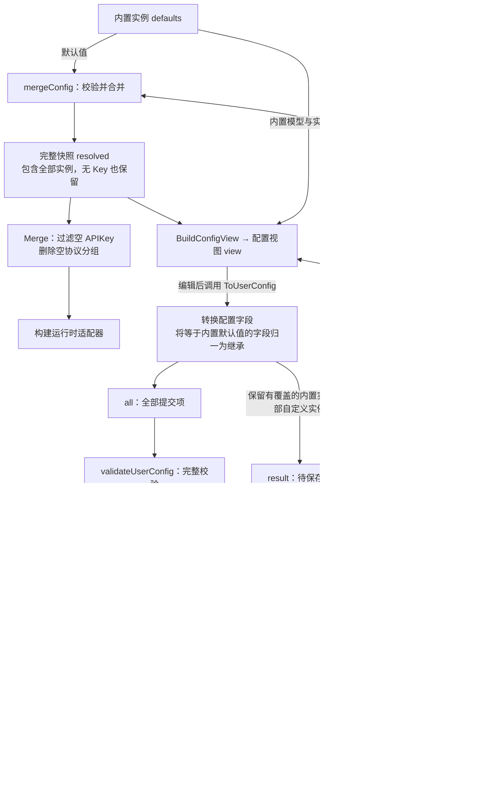

# LLM 配置数据流

配置主要有三个角色：代码提供的内置实例、持久化的用户配置、供设置页编辑的配置视图。内置实例和用户配置先合并成完整快照，再分别用于视图构建和运行时筛选。

| 数据 | Go 类型 | 内容与职责 |
| --- | --- | --- |
| 内置实例 `defaults` | `map[adapter.Protocol]ProviderMap` | 具体适配器提供的实例默认值，APIKey 留空 |
| 用户配置 `user` | `UserLLMConfig` | 内置实例的用户覆盖项，以及自定义实例的配置 |
| 完整快照 `resolved` | `map[adapter.Protocol]ProviderMap` | 全部内置和自定义实例，默认值已合并，无 Key 的实例也保留 |
| 配置视图 `view` | `LLMConfigView` / `ProviderView` | 可编辑字段、展示信息，以及分开的内置模型和用户模型 |
| 校验输入 `all` | `UserLLMConfig` | 视图全部提交项转换后的配置，用于完整校验 |
| 保存结果 `result` | `UserLLMConfig` | 需要持久化的内置覆盖项和全部自定义实例 |

`ProviderMap` 是 `map[string]adapter.Provider` 的类型别名，key 为实例 Name；外层 map 的 key 为协议。`all` 和 `result` 是同一种类型的两个局部变量，不是额外的数据类型。

## 合并与模型来源

`mergeConfig` 复制全部内置实例，再按协议和 Name 合并用户配置。内置实例允许覆盖 APIKey、非空 URL、非 nil 温度，并追加用户模型；自定义实例不继承同 ProviderType 内置实例的 URL、温度或模型。

完整快照中的模型按 ID 去重，同 ID 时内置定义优先。因此，配置视图不能直接从 `resolved.Models` 反推用户追加了哪些模型：

- `BuiltinModels` 来自 `defaults` 中的内置定义。
- `CustomModels` 来自用户配置，经 `saved` 索引查找，保留被内置同 ID 模型遮住的用户记录。
- `Source` 标记 provider 是内置实例还是自定义实例。

例如用户保存了模型 X，后来内置也增加 X：运行时只使用内置 X；配置视图的两个模型列表分别保留内置 X 和用户 X，再次保存仍保留用户记录。

## 从视图返回用户配置

`ToUserConfig` 遍历视图，为每项构造公共 provider 配置，并复制可变字段。内置实例不保存 ProviderType；URL 等于默认值时归一为 `""`，温度等于默认值时归一为 `nil`；模型只取 `CustomModels`。

转换后的每项都进入 `all`。以下任一条件满足时，同时进入 `result`：

- 是自定义实例。
- 填写了 APIKey。
- 有 URL 覆盖。
- 有温度覆盖，包括显式的 `0`。
- 有用户追加的模型。

所以，无 Key 的修改也能保存；完全未修改的内置实例省略。`all` 用来校验全部提交项，避免过滤未修改项时掩盖重复 Name 等错误；校验通过后返回 `result`。

`SaveUserConfig` 负责校验和文件读写，不负责从运行时快照反推用户修改量。`resolved` 含有展开后的内置默认值，不能直接拿来保存，否则会把这些默认值固化为用户配置。
